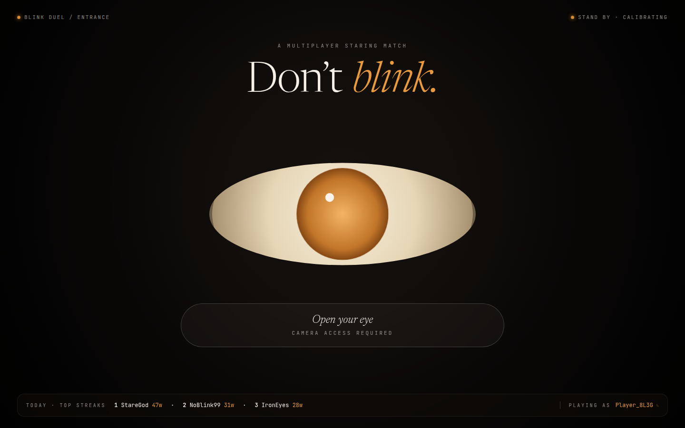

# BlinkOut — Don't Blink. Or Lose.

Real-time multiplayer staring contest. Face Mesh runs in the browser, each player starts with three lives, and the first player to blink them away loses.



## Play

| Mode | What it is |
|---|---|
| Random opponent | Join the queue and get paired with whoever is waiting |
| Invite a friend | Share a private match link |
| Practice | Solo hold. Your best time stays in this browser |

A match is best of three lives. Blinks are detected from the Eye Aspect Ratio, with a one-second cooldown between strikes. Leaving the tab, or losing the face, forfeits. During a match you can talk: voice is a direct WebRTC call, and a small JPEG preview of each player is relayed to the other.

## Tech stack

| Layer | Technology |
|---|---|
| Frontend | React 18 + Vite |
| Computer vision | MediaPipe Face Mesh (WASM, on device) |
| Real-time match | Socket.IO on Fastify |
| Voice | WebRTC, signaled through Supabase Realtime |
| Scores | Supabase Postgres |

The server uses Helmet, an origin allowlist, and rate limits. In production it refuses to start unless `CLIENT_ORIGINS` is set.

## Setup

You need Node.js 20+, a Supabase project, and two terminals.

### 1. Database

In the Supabase SQL editor, run [`server/src/db/schema.sql`](server/src/db/schema.sql).

That script creates the leaderboard and queue, the `join_queue` and `upsert_leaderboard` functions, and turns on Row Level Security. The anon key is public by design. RLS is what stops it from reading or writing tables directly. The service role key bypasses RLS, so it belongs on the server only.

### 2. Server

```bash
cd server
cp .env.example .env
npm install
npm run dev
```

Fill in `.env` from the Supabase dashboard: project URL, and the **service role** key. For local play:

```
CLIENT_ORIGINS=http://localhost:5173
NODE_ENV=development
PORT=3001
SUPABASE_URL=https://your-project.supabase.co
SUPABASE_SERVICE_ROLE_KEY=your-service-role-key
```

The API listens on `http://localhost:3001`.

### 3. Client

```bash
cd client
cp .env.example .env.local
npm install
npm run dev
```

```
VITE_SUPABASE_URL=https://your-project.supabase.co
VITE_SUPABASE_ANON_KEY=your-anon-key
VITE_SERVER_URL=http://localhost:3001
```

Open `http://localhost:5173`. The client will not start without the two Supabase variables.

`client/vercel.json` is a static-hosting example (SPA rewrite plus the cross-origin headers MediaPipe needs). Point `CLIENT_ORIGINS` at that deployed origin.

## How a match works

1. Both players allow the camera and enter the queue, or one opens an invite link.
2. The server pairs them and runs a 3-2-1 countdown.
3. MediaPipe Face Mesh runs locally. Eye Aspect Ratio is computed on the device and sent to the server as a number.
4. The server counts a blink when EAR is under 0.20 for 2 consecutive frames, then removes a life.
5. Three blinks, a forfeit, or a disconnect ends the match.
6. A win is written to the leaderboard through the `upsert_leaderboard` function, which only ever improves the stored streak and best hold.

## What leaves the device

Face landmarks are computed locally and are not uploaded.

These things do leave the browser:

- The EAR number, and whether the eyes look covered, sent to the game server over the Socket.IO connection.
- During a live match, a JPEG preview (about 5 frames per second, size-capped) relayed to the opponent through the server.
- Microphone audio, if you unmute, sent peer-to-peer over WebRTC. Signaling goes through Supabase Realtime.

## CV specification

- **Model**: MediaPipe Face Mesh (468 landmarks), loaded from `client/public/mediapipe/`
- **Eye points (left)**: 33, 159, 160, 133, 144, 145
- **EAR formula**: `(‖p2−p6‖ + ‖p3−p5‖) / (2 × ‖p1−p4‖)`
- **Blink**: EAR under 0.20 for at least 2 frames, and a fast enough drop below that player's open-eye baseline
- **Lives**: 3, with a 1 second cooldown between strikes

## Project structure

```
├── client/                 # React + Vite
│   ├── public/mediapipe/   # Face Mesh runtime (Apache-2.0)
│   └── src/
│       ├── components/     # lobby, match, practice, invite
│       ├── hooks/          # camera, blink detection, socket, voice
│       └── lib/            # EAR math, sounds, Supabase client
└── server/                 # Fastify + Socket.IO
    └── src/
        ├── socket/         # matchmaking and the match state machine
        └── db/             # Supabase client and schema.sql
```

## Third-party media

The files in [`client/public/mediapipe/`](client/public/mediapipe/) are unmodified assets from `@mediapipe/face_mesh` 0.4.1633559619, Copyright The MediaPipe Authors, under the [Apache License 2.0](client/public/mediapipe/LICENSE). See [`client/public/mediapipe/NOTICE`](client/public/mediapipe/NOTICE).

## License

[MIT](LICENSE). The MediaPipe assets keep their own Apache-2.0 license.
